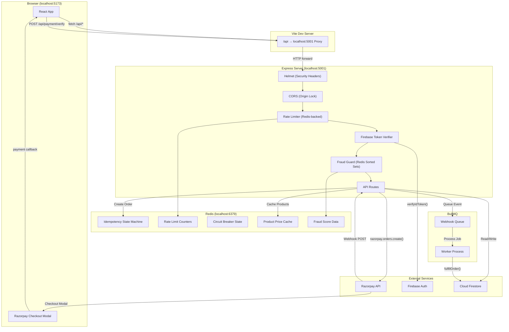
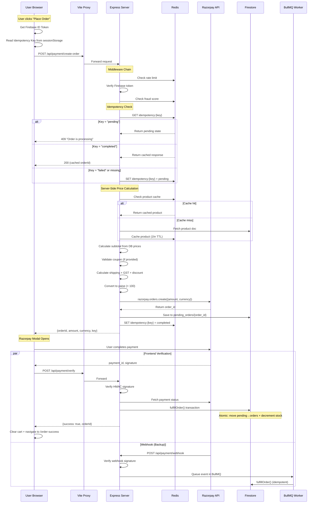
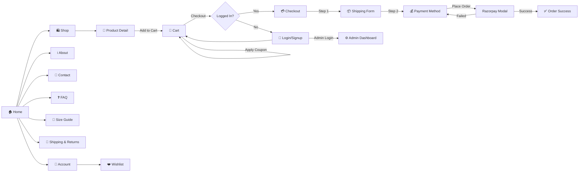
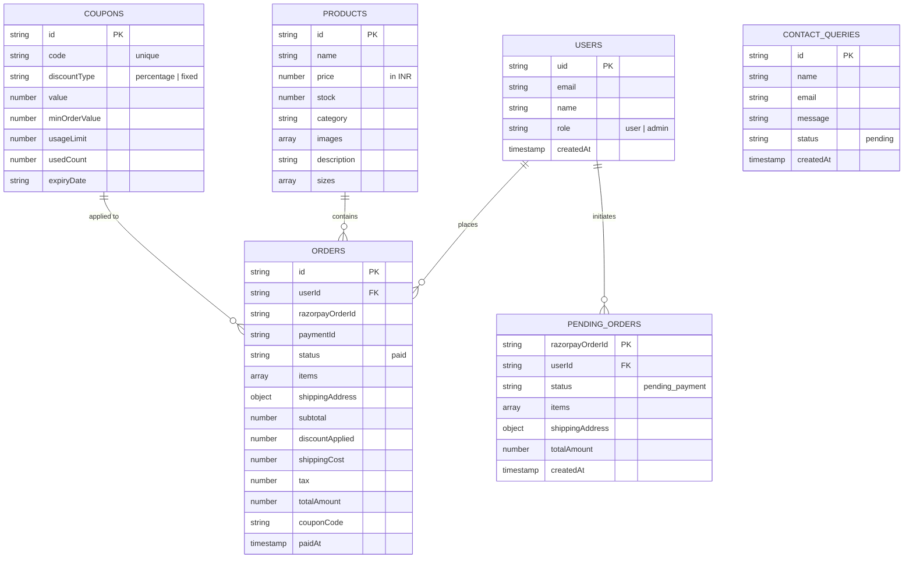
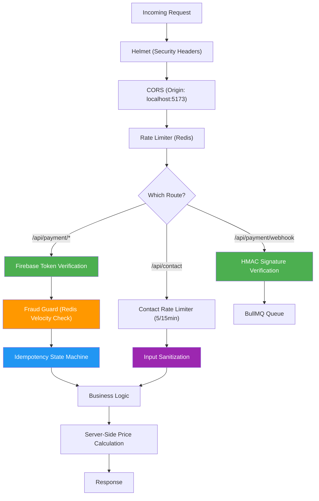
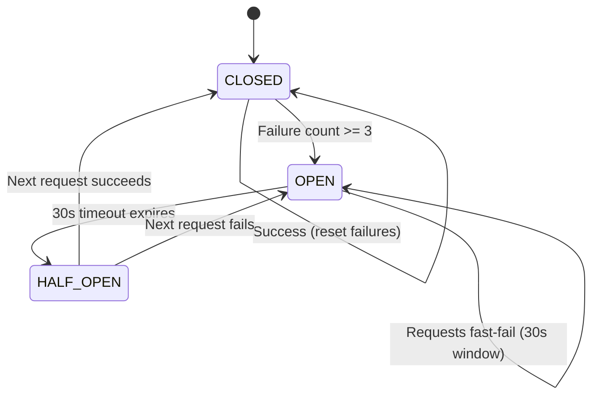

# MJ Store — System Architecture & Implementation Guide

## Tech Stack Overview

| Layer | Technology | Purpose |
|-------|-----------|---------|
| **Frontend** | React 19 + Vite 8 | Single-page application with client-side routing |
| **Styling** | TailwindCSS 3 | Utility-first CSS framework |
| **Routing** | React Router 7 | Client-side page navigation |
| **State** | useReducer + Context API | Global cart, user, wishlist, orders state |
| **Animation** | GSAP 3 | Smooth page transitions and micro-interactions |
| **Auth** | Firebase Authentication | Email/password login and signup |
| **Database** | Cloud Firestore | NoSQL document database for products, orders, users |
| **Backend** | Node.js + Express 4 | REST API server for payments, coupons, contact |
| **Payments** | Razorpay | Indian payment gateway (UPI, cards, net banking) |
| **Cache** | Redis 8 | Idempotency keys, rate limiting, circuit breaker state, product cache |
| **Queue** | BullMQ | Async webhook processing with retry and dead-letter support |
| **Monitoring** | Prometheus + Winston + AsyncLocalStorage | Metrics, Distributed Tracing, and structured logging |
| **Resilience** | PM2 + Custom Chaos Hooks | Zero-Downtime Clustering & Failure injection simulations |
| **Security** | Helmet + CORS + Rate Limiting | HTTP hardening, origin restriction, abuse prevention |

---

## Project Structure

```
MJ Store/
├── index.html                  # Entry HTML (loads Razorpay script + Vite app)
├── vite.config.js              # Vite dev server + /api proxy to Express
├── package.json                # Frontend dependencies
│
├── src/                        # ── FRONTEND ──
│   ├── main.jsx                # React DOM mount point
│   ├── App.jsx                 # Route definitions
│   ├── firebase.js             # Firebase client SDK init
│   ├── index.css               # Global styles + Tailwind
│   │
│   ├── context/
│   │   └── StoreContext.jsx    # Global state (cart, user, orders, wishlist)
│   │
│   ├── components/
│   │   ├── layout/
│   │   │   ├── Navbar.jsx      # Top navigation bar
│   │   │   └── Footer.jsx      # Site footer with links
│   │   └── ui/
│   │       ├── ProductCard.jsx # Product grid card
│   │       └── Reviews.jsx     # Product review system
│   │
│   └── pages/
│       ├── Home.jsx            # Landing page
│       ├── Shop.jsx            # Product catalog
│       ├── ProductDetail.jsx   # Single product view
│       ├── Cart.jsx            # Shopping bag + coupon input
│       ├── Checkout.jsx        # Shipping form + Razorpay payment
│       ├── OrderSuccess.jsx    # Post-payment confirmation
│       ├── Login.jsx           # Email/password auth
│       ├── Account.jsx         # User profile + order history
│       ├── Admin.jsx           # Admin dashboard (products, orders, analytics)
│       ├── Wishlist.jsx        # Saved items
│       ├── About.jsx           # Brand story
│       ├── Contact.jsx         # Contact form → backend API
│       ├── FAQ.jsx             # Frequently asked questions
│       ├── SizeGuide.jsx       # Shoe sizing chart
│       └── ShippingReturns.jsx # Shipping & return policy
│
└── server/                     # ── BACKEND ──
    ├── index.js                # Express app (routes, middleware, business logic)
    ├── redis.js                # Redis connection (ioredis)
    ├── breaker.js              # Circuit breaker (Redis-backed)
    ├── worker.js               # BullMQ webhook processor
    ├── logger.js               # Winston structured logging
    ├── alert-transport.js      # Alert notifications for critical failures
    ├── seed-coupons.js         # Script to seed coupon data into Firestore
    ├── backup.js               # Firestore backup utility
    ├── restore.js              # Firestore restore utility
    ├── retry-webhooks.js       # Manual webhook retry tool
    ├── cleanup.js              # Autonomous 30-Day Firebase log retention executor
    ├── throttle.js             # Adaptive progressive latency scaling
    ├── trace.js                # Native AsyncLocalStorage OpenTelemetry Contexts
    ├── ecosystem.config.cjs    # PM2 Clustering & Zero-Downtime Deployment Maps
    ├── loadtest.js             # Checkout Flow concurrency load tester
    ├── deploy.sh               # CI/CD Rolling deploy executor
    ├── .env                    # Environment variables (secrets)
    └── firebase-service-account.json  # Firebase Admin SDK credentials
```

---

## System Architecture Diagram



---

## Payment Flow (Step-by-Step)



---

## User Journey Flow



---

## Firestore Data Model



---

## Backend API Reference

| Method | Endpoint | Auth | Rate Limit | Purpose |
|--------|----------|------|-----------|---------|
| `GET` | `/api/health` | No | Global | System health + DB connectivity check |
| `GET` | `/api/metrics` | No | Global | Prometheus metrics endpoint |
| `POST` | `/api/contact` | No | 5/15min | Submit contact form → Firestore |
| `POST` | `/api/coupons/validate` | No | 15/15min | Validate coupon code server-side |
| `POST` | `/api/payment/create-order` | Firebase Token | 15/15min | Create Razorpay order + pending record |
| `POST` | `/api/payment/verify` | Firebase Token | Global | Verify payment signature + fulfill order |
| `POST` | `/api/payment/webhook` | Razorpay Signature | 200/15min | Receive Razorpay webhook events |
| `POST` | `/api/metrics/abandonment` | Redis Native Dedup | - | Tracks raw UX checkout abandonment gracefully |
| `GET` | `/api/order/status/:id` | Firebase Token | Global | Retrieves individual Track-Order states securely |

---

## Security Architecture



### Security Layers Explained

1. **Helmet** — Sets secure HTTP headers (X-Content-Type-Options, X-Frame-Options, etc.)
2. **CORS** — Only accepts requests from the frontend origin, blocks all others
3. **Rate Limiting** — Redis-backed sliding window counters prevent brute force
4. **Firebase Token Verification** — Decodes and validates JWT on every protected route
5. **Fraud Guard** — Tracks order velocity per user using Redis sorted sets; blocks if >5 attempts in 15 minutes
6. **Idempotency** — Redis state machine (pending/completed/failed) prevents duplicate orders
7. **Input Sanitization** — Strips `< > ' " &` from all user inputs before database writes
8. **Zero-Trust Pricing** — Frontend prices are completely ignored; server recalculates from Firestore

---

## Circuit Breaker Pattern



The circuit breaker wraps all Razorpay API calls. If Razorpay is down:
- After 3 consecutive failures → circuit **OPENS** → all requests immediately fail without hitting Razorpay
- After 30 seconds → circuit moves to **HALF_OPEN** → allows one test request
- If test succeeds → circuit **CLOSES** → normal operation resumes

---

## Distributed Native Tracing
Leveraging `AsyncLocalStorage`, every HTTP request inherits an autonomous OpenTelemetry-compliant trace architecture.
`[Trace: e4b2xyz...] [UID: 123...] [Route: /api/checkout]`
This explicitly ensures log aggregation systems (like Datadog/ELK) can instantly filter end-to-end webhook/payment pipelines precisely.

---

## How to Run (Production)

Your infrastructure executes leveraging **PM2 Cluster Mode** enabling Zero-Downtime deployments effortlessly.

```bash
# 1. Native Dependencies
npm ci --omit=dev

# 2. Spawn PM2 Clusters dynamically detecting hardware CPU ranges
pm2 start server/ecosystem.config.cjs

# 3. Rolling Deploy without dropping HTTP connections
pm2 reload mjstore-api
```

---

## The 10-Point Ultimate Launch Verification

Before traffic gates open organically, resolve these validations natively:

1. **PM2 Stability:** `pm2 status` shows clustered nodes active cleanly.
2. **Web Domain DNS:** Verify SSL cert locks load correctly over the edge maps natively.
3. **Live Transaction Guard:** Toggle Razorpay LIVE, alter product price to `₹1` organically, execute real bank test.
4. **Webhook Security:** Verify Razorpay logs received `200 OK` safely validating routing boundaries effortlessly.
5. **Database Storage:** Check `orders` collection safely mirroring the live test.
6. **DKIM Email:** Ensure Order Confirmations inherently hit the Primary Inbox precisely cleanly bypassing Spam constraints.
7. **TrackOrder Tool:** Verify `/track-order` successfully loads the status strictly securely locking out random users gracefully.
8. **Frontend Diagnostics:** Console logs throw zero errors safely verifying dependency hooks organically.
9. **Trace Reads:** `pm2 logs mjstore-api` dynamically outputs Trace contexts correctly cleanly formatted natively.
10. **Recovery Security:** Trigger `node server/backup.js` ensuring administrative cron sweeps effortlessly operate smoothly exactly as specified.
